# Swing-up et stabilisation d'un pendule inversé simple et double sur chariot

Modélisation par les équations de Lagrange, commande optimale LQR et étude des limites en présence de saturation de l'actionneur — MATLAB.

<p align="center">
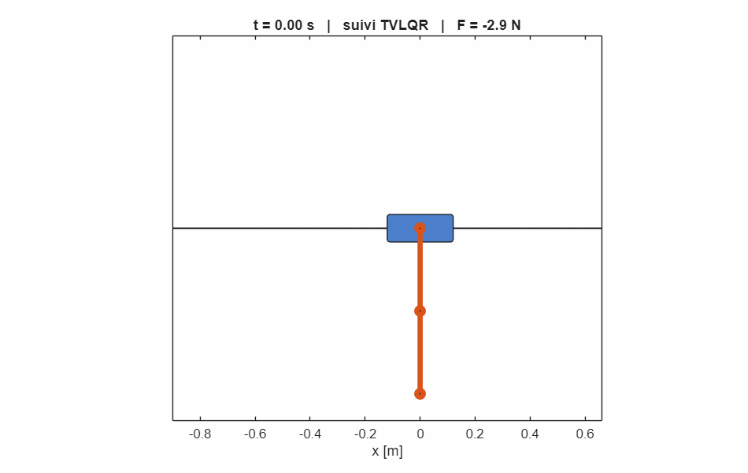
</p>

## Points clés

- Modèle non linéaire établi **à la main** par les équations de Lagrange, puis automatisé et généralisé à *N* barres avec la Symbolic Math Toolbox
- Validation du modèle : **conservation de l'énergie** (dérive < 1e-8 J sans frottement) et cohérence des pôles avec le calcul manuel
- Commande **LQR** conçue sur le modèle linéarisé, testée sur le modèle **non linéaire complet**
- Étude de la **saturation moteur** (±10 N) : domaine de stabilisation de **45°** pour le pendule simple contre **15°** pour le double pendule
- **Swing-up** depuis la position basse : pompage d'énergie pour le pendule simple, optimisation de trajectoire (collocation directe) et suivi par **TVLQR** pour le double pendule, robuste à une perturbation initiale de 45°
- **Filtre de Kalman** sur mesures bruitées de x et θ (commande LQG à 100 Hz) : bruit sur la force divisé par 11 par rapport à la dérivation des mesures

## Contenu du dépôt

```
src/
├── derive_eom.m          Modèle du pendule simple (Lagrange, linéarisation, validation)
├── derive_eom_nlink.m    Modèle générique à N barres (utilisé avec N = 2)
├── lqr_pendule.m         Commande LQR du pendule simple
├── lqr_double.m          Commande LQR du double pendule
├── animate_pendulum.m    Animation (GIF) du pendule simple ou double
├── swingup_pendule.m     Swing-up du pendule simple (pompage d'énergie + LQR)
├── traj_opt_double.m     Swing-up du double pendule : optimisation de trajectoire
├── tvlqr_double.m        Swing-up du double pendule : suivi TVLQR + LQR
├── kalman_pendule.m      Mesures bruitées : dérivation vs filtre de Kalman (LQG)

figures/                  Résultats de simulation et animations
```

---

## 1. Modélisation du pendule simple

**État :** $X = [x,\ \theta,\ \dot{x},\ \dot{\theta}]$, avec $\theta = 0$ en position haute.
**Commande :** force $F$ appliquée au chariot.

Le lagrangien $L = T - V$ s'écrit :

$$
L = \tfrac{1}{2}(M+m)\dot{x}^2 + ml\cos\theta\,\dot{x}\dot{\theta} + \tfrac{1}{2}(J+ml^2)\dot{\theta}^2 - mgl\cos\theta
$$

Le terme $ml\cos\theta\,\dot{x}\dot{\theta}$ couple le chariot et le pendule : c'est lui qui rend le système commandable avec une seule entrée.

Les équations de Lagrange donnent :

$$
(M+m)\ddot{x} + ml\cos\theta\,\ddot{\theta} - ml\sin\theta\,\dot{\theta}^2 + b\dot{x} = F
$$

$$
(J+ml^2)\ddot{\theta} + ml\cos\theta\,\ddot{x} - mgl\sin\theta = 0
$$

**Linéarisation** autour de la position haute ($\sin\theta \approx \theta$, $\cos\theta \approx 1$, $\dot{\theta}^2 \approx 0$) :

$$(M+m)\ddot{x} + ml\,\ddot{\theta} + b\dot{x} = F$$

$$ml\,\ddot{x} + (J+ml^2)\ddot{\theta} - mgl\,\theta = 0$$

L'inversion de la matrice de masse donne la représentation d'état $\dot{X} = AX + BF$.

**Paramètres :** $M = 0{,}5$ kg, $m = 0{,}2$ kg, $l = 0{,}3$ m, $J = 0{,}006$ kg·m², $b = 0{,}1$ N·s/m.

### Validation du modèle

| Test | Résultat |
|---|---|
| Pôles en boucle ouverte | 0 ; **+5,57** ; −5,61 ; −0,14 |
| Pôle instable prévu à la main (sans frottement) | ±5,6 rad/s ✓ |
| Dérive d'énergie (b = 0, 3 s) | 4,6e-9 J ✓ |

<p align="center">
  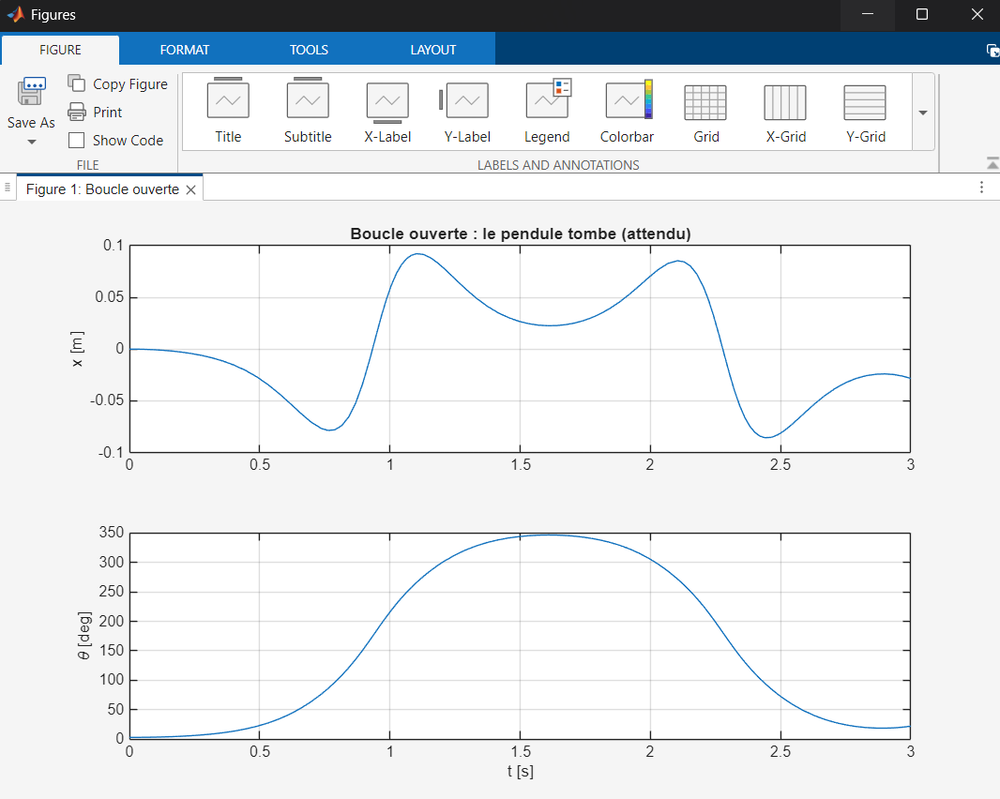
</p>

En boucle ouverte, le pendule tombe puis se balance autour de sa position basse. Le chariot bouge en sens inverse du pendule : le centre de gravité commun reste quasiment immobile.

---

## 2. Commande LQR du pendule simple

La loi de commande est un retour d'état $F = -KX$. Le gain $K$ minimise :

$$
J = \int_0^\infty \left( X^\top Q X + R\,F^2 \right) dt
\qquad Q = \mathrm{diag}(10,\ 100,\ 1,\ 1), \quad R = 1
$$

La priorité est donnée à l'angle du pendule (100), puis au retour du chariot au centre (10).

| | Valeur |
|---|---|
| Gain $K$ | [−3,16 ; −28,61 ; −3,98 ; −5,18] |
| Pôles en boucle fermée | −7,03 ± 2,59i (pendule) ; −1,23 ± 1,01i (chariot) |
| Temps d'établissement du chariot | ≈ 3,3 s |

<p align="center">
  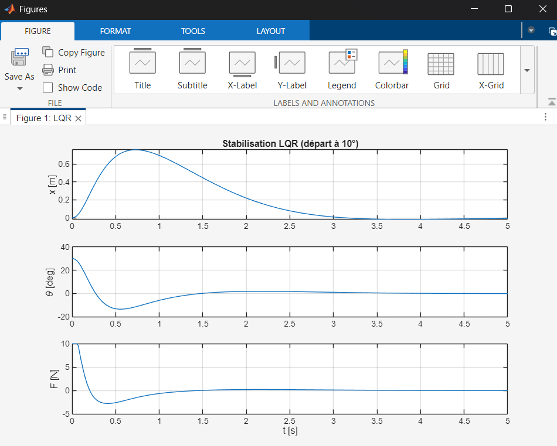
</p>

**Observation :** pour ramener le chariot au centre, le contrôleur fait d'abord pencher légèrement le pendule dans la direction du retour (θ ≈ −3,5°), puis le chariot « suit » cette inclinaison. Le système est à **non-minimum de phase** : pour aller à gauche, il faut d'abord pousser à droite.

### Limites en présence de saturation (±10 N)

| Angle initial | Résultat | Déplacement max du chariot |
|---|---|---|
| 10° | stabilisé | 0,2 m |
| 30° | stabilisé | 0,75 m |
| 40° | stabilisé | 1,3 m |
| 45° | stabilisé (limite) | 1,8 m |
| 50° | **échec** | — |

<p align="center">
  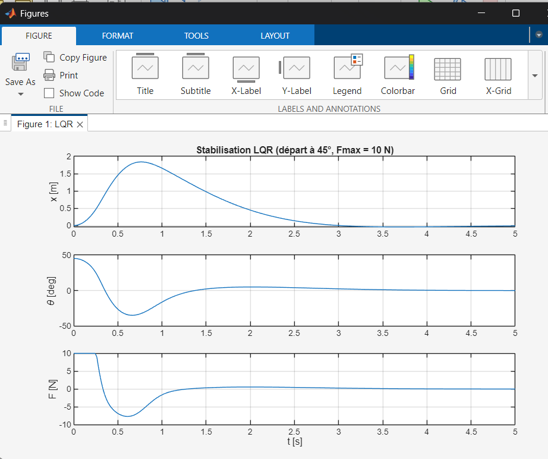
  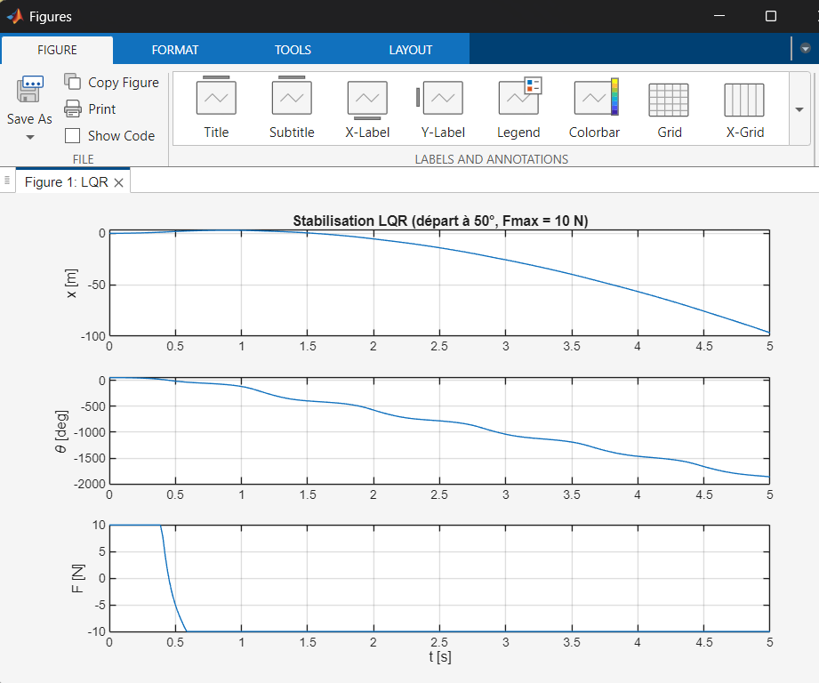
</p>

<p align="center">
  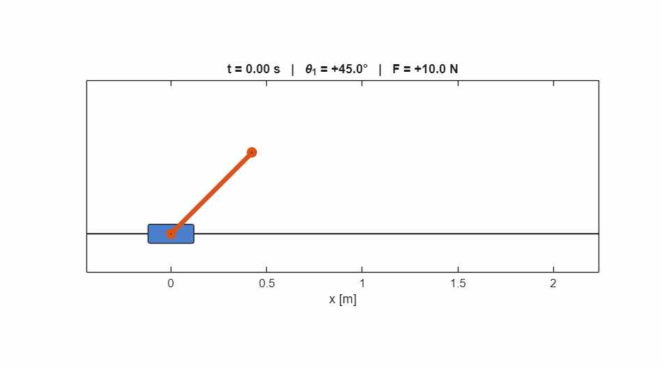
</p>

Le pendule simple **tolère une saturation temporaire** : jusqu'à 45°, le moteur reste bloqué à 10 N pendant une fraction de seconde mais le pendule est rattrapé. Sur un banc réel, la longueur des rails serait cependant la contrainte la plus limitante.

---

## 3. Double pendule inversé

Le modèle est généré par `derive_eom_nlink.m` sous forme matricielle $M(q)\ddot{q} + h(q,\dot{q}) = Q$, avec des angles absolus mesurés depuis la verticale. Le système compte 3 degrés de liberté, soit **6 états**.

**Paramètres :** chariot 1 kg, deux barres de 0,1 kg et 0,3 m.

| Test | Résultat |
|---|---|
| Pôles instables | **+13,3** (déformation en zigzag) ; **+5,2** (basculement d'un bloc) |
| Commandabilité | rang 6/6, conditionnement 2e5 |
| Dérive d'énergie (b = 0) | 6,7e-10 J ✓ |

<p align="center">
  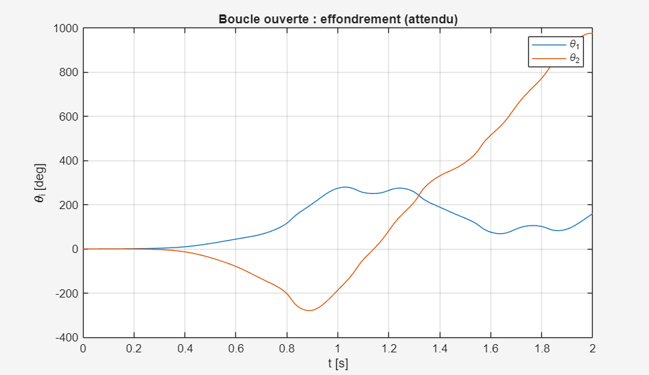
</p>

En boucle ouverte, le mode le plus rapide (zigzag) domine dès 0,3 s, puis le mouvement devient chaotique.

### Commande LQR

Même méthode, avec $Q = \mathrm{diag}(10,\ 100,\ 100,\ 1,\ 1,\ 1)$ et $R = 1$.

| | Valeur |
|---|---|
| Gain $K$ | [3,16 ; −141,7 ; 167,8 ; 4,94 ; −3,20 ; 16,34] |
| Pôles en boucle fermée | −15,1 ; −11,9 ; −5,98 ± 2,53i ; −0,97 ± 0,86i |

Les gains sur les angles sont de **signes opposés** : le contrôleur réagit à la différence entre les deux barres, c'est-à-dire au début d'une déformation en zigzag. Au démarrage, il tire d'abord le chariot dans le mauvais sens pour redresser la barre supérieure, avant de rattraper l'ensemble.

### Limites en présence de saturation (±10 N)

| Angle initial | Résultat | Force max | Déplacement max du chariot |
|---|---|---|---|
| 5° | stabilisé | 2,7 N | 0,2 m |
| 10° | stabilisé | 5,5 N | 0,4 m |
| 15° | stabilisé (limite) | ≈ 9 N | 0,6 m |
| 20° | **échec** | saturée | — |

<p align="center">
  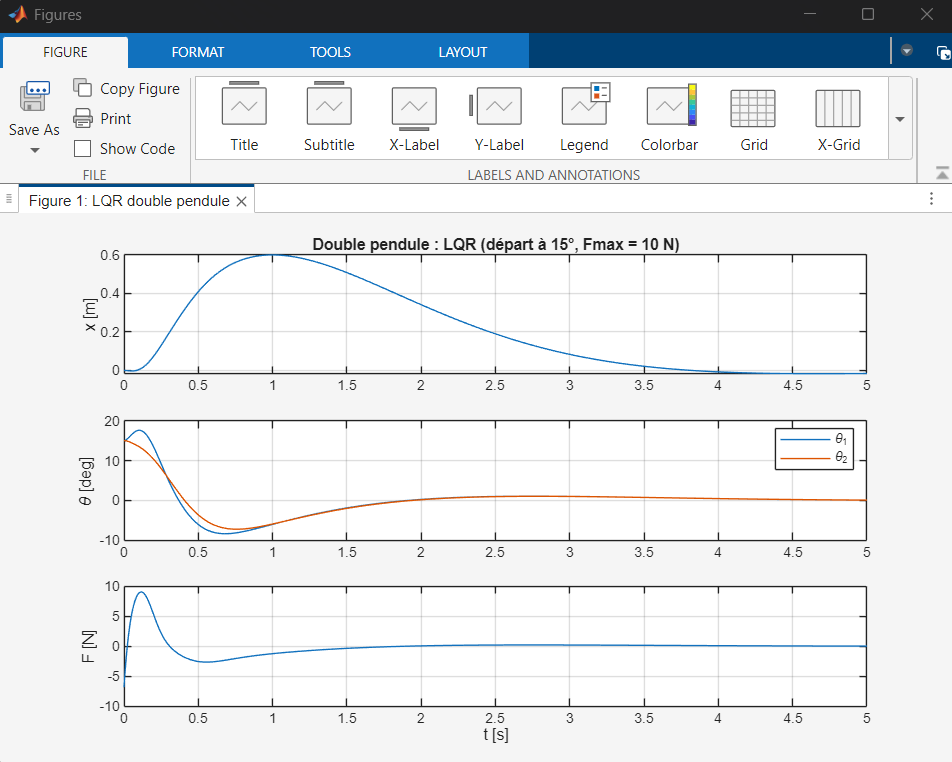
  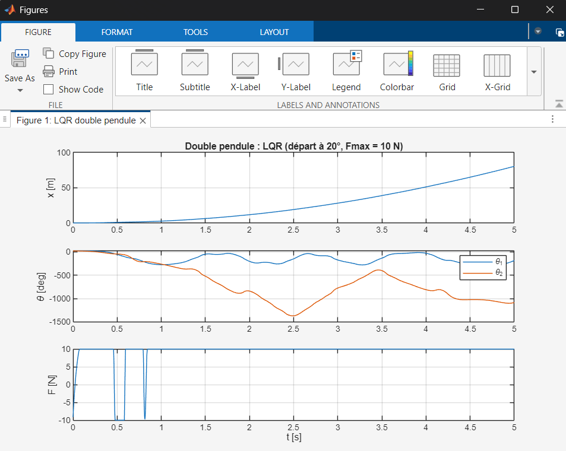
</p>

---

## 4. Analyse

| | Pendule simple | Double pendule |
|---|---|---|
| Pôles instables | 1 (+5,6) | 2 (+13,3 ; +5,2) |
| Gain maximal sur un angle | 28,6 | 167,8 |
| Angle initial maximal (±10 N) | **45°** | **15°** |
| Tolérance à la saturation | oui | non |

Contrairement au pendule simple, le double pendule **ne tolère aucune saturation** : dès que la force demandée dépasse 10 N, la coordination fine entre les deux barres est rompue et le mode instable rapide diverge en une fraction de seconde. Les gains élevés rendent aussi ce système beaucoup plus sensible au bruit de mesure.

---
 
## 5. Swing-up : partir de la position basse
 
Le LQR ne fonctionne qu'au voisinage de la verticale (45° pour le pendule simple, 15° pour le double). Pour amener le système depuis la position **basse**, il faut une commande non linéaire, puis une bascule vers le LQR.
 
### 5.1 Pendule simple : pompage d'énergie
 
<p align="center">
  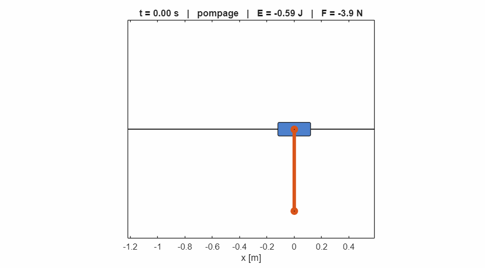
</p>
L'énergie du pendule (θ = 0 en haut) vaut :
 
$$E = \tfrac{1}{2}(J+ml^2)\dot{\theta}^2 + mgl\cos\theta$$
 
Elle vaut −mgl en bas et +mgl en haut (cible $E_{ref}$). En dérivant et en utilisant l'équation du pendule :
 
$$\dot{E} = -ml\,\ddot{x}\,\dot{\theta}\cos\theta$$
 
L'énergie ne varie que par l'accélération du chariot. On choisit donc :
 
$$\ddot{x} = k_E\,(E - E_{ref})\,\mathrm{sign}(\dot{\theta}\cos\theta)$$
 
Le chariot accélère toujours dans le sens qui injecte de l'énergie, et le pompage s'arrête de lui-même quand E atteint $E_{ref}$. Le LQR prend la main lorsque |θ| < 25° et |θ̇| < 2 rad/s.
 
| Résultat | Valeur |
|---|---|
| Bascule vers le LQR | t = 3,97 s |
| Force maximale | 6,4 N (pas de saturation) |
| Angle final | −0,01° |
 
<p align="center">
  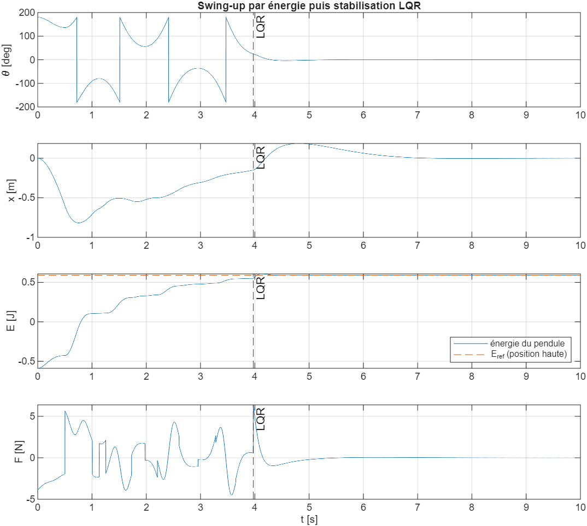
</p>
L'énergie monte par paliers, un par oscillation. Les paliers plats correspondent aux points de rebroussement (θ̇ = 0), où aucune énergie ne peut être injectée. Le chariot s'écarte jusqu'à 0,8 m : sur un banc réel, il faudrait renforcer le recentrage, au prix d'une montée plus lente.
 
### 5.2 Double pendule : optimisation de trajectoire + TVLQR
 
Pour le double pendule, atteindre l'énergie maximale ne suffit pas : de nombreuses configurations (dont des mouvements chaotiques) ont la même énergie totale. Les deux barres doivent arriver en haut **ensemble**, avec des vitesses quasi nulles.
 
<p align="center">
  
</p>
**Étape 1 — Optimisation de trajectoire** (`traj_opt_double.m`). La manœuvre de 3 s est discrétisée en 61 instants. `fmincon` cherche l'état et la force à chaque instant en minimisant l'effort $\int F^2\,dt$, sous les contraintes :
- dynamique respectée entre deux instants (collocation par la règle des trapèzes) ;
- départ : les deux barres pendues ; arrivée : les deux barres debout, immobiles ;
- |F| ≤ 20 N et |x| ≤ 1 m.
| Résultat | Valeur |
|---|---|
| Convergence | exitflag = 1, 59 s de calcul |
| Force maximale | 8,3 N |
| Déplacement max du chariot | 0,50 m |
 
La trajectoire trouvée tient donc dans les limites du moteur (10 N) et de rails de ±0,5 m.
 
<p align="center">
  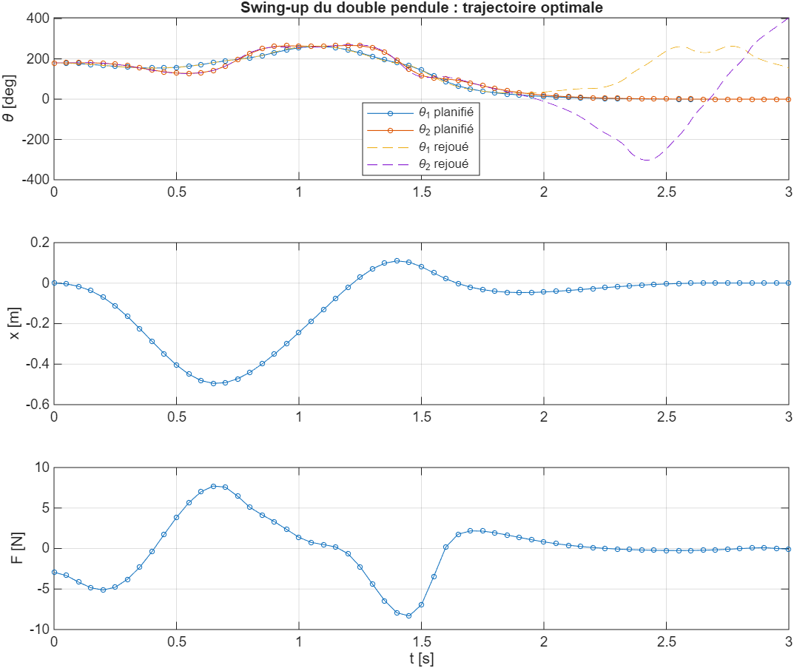
</p>
Rejouée **en boucle ouverte** sur le modèle complet, cette commande diverge dès l'approche de la position haute (θ₂ = 404° en fin de manœuvre) : le système est chaotique et les petites erreurs d'approximation grandissent très vite près de l'équilibre instable.
 
**Étape 2 — Suivi par TVLQR** (`tvlqr_double.m`). La commande devient :
 
$$F(t) = F_{plan}(t) - K(t)\,\big(X(t) - X_{plan}(t)\big)$$
 
Le gain K(t) varie dans le temps. Il est obtenu en linéarisant le modèle le long de la trajectoire, puis en résolvant l'équation de Riccati différentielle **à rebours**, à partir de la solution du LQR de la position haute :
 
$$-\dot{S} = A(t)^\top S + S A(t) - S B(t) R^{-1} B(t)^\top S + Q, \qquad K(t) = R^{-1} B(t)^\top S(t)$$
 
À la fin de la manœuvre, K(t) coïncide avec le gain LQR haut (écart 8,8e-9) : la bascule se fait sans discontinuité.
 
<p align="center">
  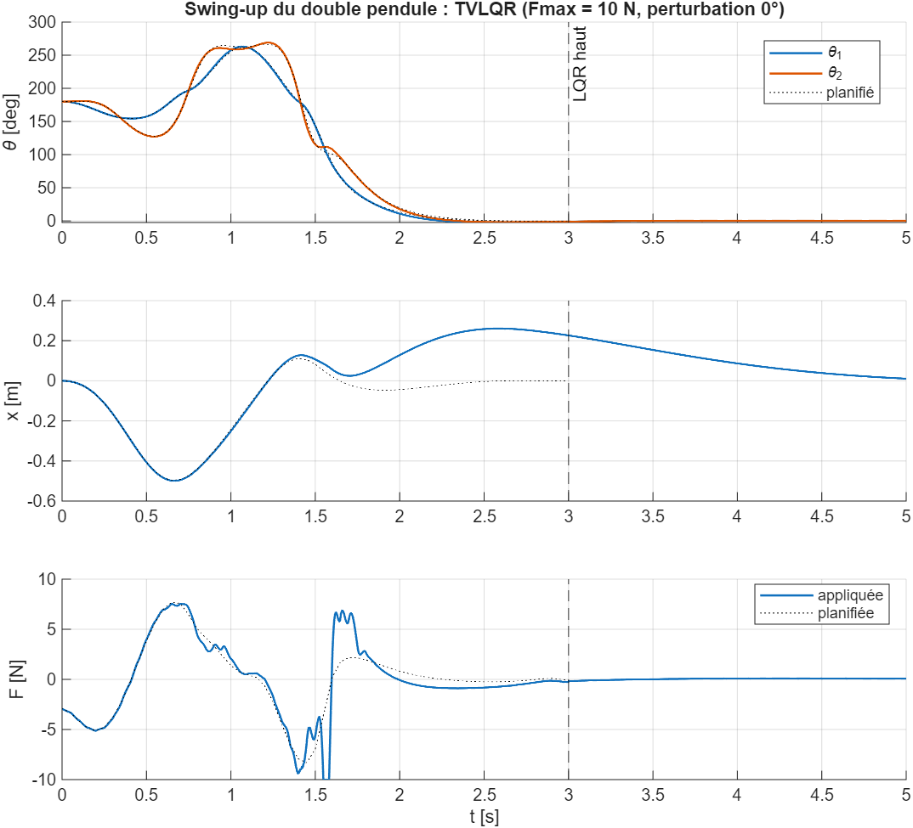
</p>
Les angles suivent la trajectoire planifiée et finissent à +0,34°. La correction est faible pendant la phase basse, puis importante entre 1,4 et 1,8 s, quand les barres passent l'horizontale : c'est précisément là que la boucle ouverte divergeait.
 
### 5.3 Robustesse : perturbation de la barre inférieure au départ
 
| Perturbation initiale | Résultat | Chariot max |
|---|---|---|
| 0° à 10° | réussi | ≤ 0,5 m |
| 20° | réussi | 0,32 m |
| 45° | réussi, rails légèrement dépassés | ≈ 0,55 m |
| 75° | réussi en simulation, rails dépassés | 0,8 m |
| 80° | **échec** | — |
 
Le LQR seul ne tolère que 15° d'écart près de la position haute, alors que le TVLQR rejette une erreur de 45° au départ. **Une même erreur n'a pas le même poids selon l'endroit de la trajectoire** : en bas, le système est stable et le contrôleur a le temps de corriger avant la phase critique.
 
**Limite identifiée :** à 80°, l'erreur de suivi n'est pas résorbée avant la fin de la manœuvre et l'état final sort du domaine de stabilisation du LQR haut. Augmenter le poids des angles (Q = 1000) aggrave l'échec : le contrôleur réclame davantage de force et le moteur reste saturé à 10 N pendant plus d'une seconde. La limite vient donc de la saturation de l'actionneur. Pour aller au-delà, il faudrait replanifier une nouvelle trajectoire depuis l'état réel, ou disposer d'un moteur plus puissant.
## 6. Mesures bruitées : filtre de Kalman (LQG)
 
Sur un banc réel, seules les positions x et θ sont mesurées, par des codeurs bruités. Les vitesses, nécessaires au gain LQR, doivent être estimées. Le script `kalman_pendule.m` compare trois versions de la même commande LQR du pendule simple :
 
1. l'état réel complet (cas idéal, référence) ;
2. les vitesses obtenues en dérivant les mesures ;
3. l'état estimé par un filtre de Kalman, soit une commande **LQG**.
**Conditions :** commande numérique à 100 Hz, bruit de 0,5 mm sur x et de 0,2° sur θ, saturation à 10 N, départ à 10° et poussée de 5 N pendant 0,1 s à t = 2 s.
 
À chaque pas, le filtre **prédit** l'état à partir du modèle discret, puis le **corrige** avec la mesure :
 
$$\hat{x}_k^- = A_d\,\hat{x}_{k-1} + B_d\,u_{k-1} \qquad \hat{x}_k = \hat{x}_k^- + L\,(y_k - C\,\hat{x}_k^-)$$
 
Le gain L est obtenu par l'équation de Riccati discrète, à partir de la confiance accordée aux capteurs (bruits des codeurs) et au modèle (forces inconnues d'écart-type σ_w). Par le principe de séparation, le LQR et le filtre sont conçus indépendamment.
 
<p align="center">
  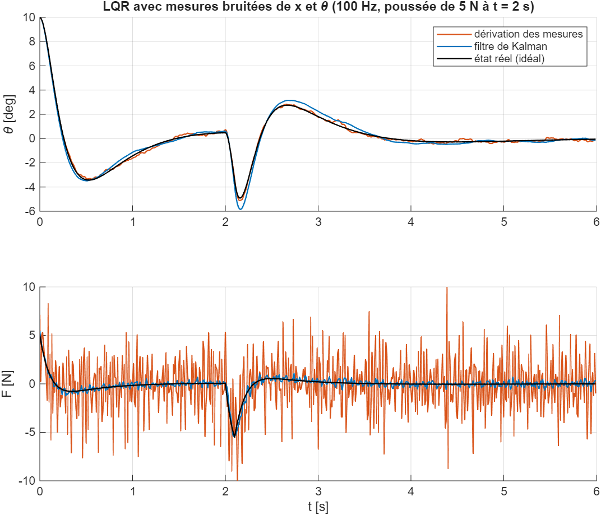
</p>
| | État réel | Dérivation | Kalman (σ_w = 2 N) |
|---|---|---|---|
| θ max après la poussée | 4,91° | 5,11° | 5,84° |
| Bruit sur θ (écart-type) | 0,072° | 0,121° | 0,139° |
| Bruit sur la force | 0,01 N | 2,84 N | **0,25 N** |
| Erreur d'estimation de θ̇ | — | 0,469 rad/s | **0,069 rad/s** |
 
La dérivation stabilise le pendule, mais la force oscille en permanence de plusieurs newtons : sur un moteur réel, cela provoquerait échauffement et vibrations. Le filtre de Kalman **divise ce bruit par 11** et estime la vitesse **7 fois plus précisément**.
 
<p align="center">
  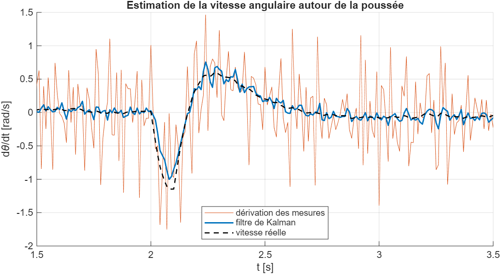
</p>
**Le compromis du réglage.** σ_w traduit la confiance accordée au modèle :
 
| σ_w | Réaction à la poussée | Bruit sur la force |
|---|---|---|
| 0,5 N | lente (θ jusqu'à −7,5°) | très faible |
| 2 N (retenu) | proche de l'idéal | faible |
| 5 N | quasi idéale | modéré (±1,5 N) |
 
Un filtre qui fait trop confiance au modèle tarde à « croire » une perturbation imprévue ; un filtre qui fait trop confiance aux mesures laisse passer leur bruit.
 
**Pôles :** l'estimateur possède deux pôles rapides (−61 ± 63i), environ 9 fois plus rapides que ceux de la commande (−7 ± 2,6i), et deux pôles plus lents (−5,3 ± 2i) dans les directions où le filtre privilégie le modèle.

## 7. Utilisation
 
**Prérequis :** MATLAB avec Symbolic Math Toolbox et Control System Toolbox. L'Optimization Toolbox est nécessaire pour le swing-up du double pendule.
 
Tous les scripts se lancent depuis le dossier `src/`. Les scripts `derive_*` génèrent des fonctions (`cartpole_*.m`, `nlink_*.m`, `nlink_model.mat`) utilisées par les scripts suivants : ils doivent donc être lancés en premier.
 
```matlab
cd src
 
% --- Pendule simple ---
derive_eom          % modèle, linéarisation et validation
lqr_pendule         % stabilisation LQR (régler angle0 et Fmax en tête de script)
swingup_pendule     % swing-up par énergie puis LQR (génère un GIF)
kalman_pendule      % LQR avec mesures bruitées : dérivation vs Kalman (régler sig_w)

 
% --- Double pendule (derive_eom_nlink.m avec N = 2) ---
derive_eom_nlink    % modèle à N barres
lqr_double          % stabilisation LQR
traj_opt_double     % recherche de la trajectoire de swing-up (~1 min, fmincon)
tvlqr_double        % suivi de la trajectoire par TVLQR (régler dth0 pour perturber)
 
% --- Animations ---
animate_pendulum    % GIF de la stabilisation (choisir 'simple' ou 'double')
```
 
| Paramètre | Script | Rôle |
|---|---|---|
| `angle0` | `lqr_pendule`, `lqr_double`, `animate_pendulum` | inclinaison initiale [deg] |
| `Fmax` | tous les scripts de commande | saturation du moteur [N] |
| `kE`, `thSw`, `dthSw` | `swingup_pendule` | gain de pompage et seuils de bascule vers le LQR |
| `T`, `Nn` | `traj_opt_double` | durée de la manœuvre et nombre de noeuds |
| `dth0` | `tvlqr_double` | perturbation initiale de la barre inférieure [deg] |
| `sig_w` | `kalman_pendule` | confiance du filtre dans le modèle [N] |

 
## 8. Prochaines étapes
 
- [x] Animation du chariot et des barres
- [x] Swing-up par contrôle de l'énergie (pendule simple)
- [x] Swing-up du double pendule (optimisation de trajectoire + TVLQR)
- [ ] Détection d'échec et nouvelle tentative de swing-up
- [x] Observateur de Kalman (mesure de x et θ seulement)
- [ ] Validation du modèle dans Simscape Multibody

---

**Auteur :** Taha Bouchama — Master 1 AM2AS (Automatique, Mécatronique, Aéronautique & Spatial), Université de Bordeaux
[LinkedIn](https://www.linkedin.com/in/taha-bouchama-981085266/)
