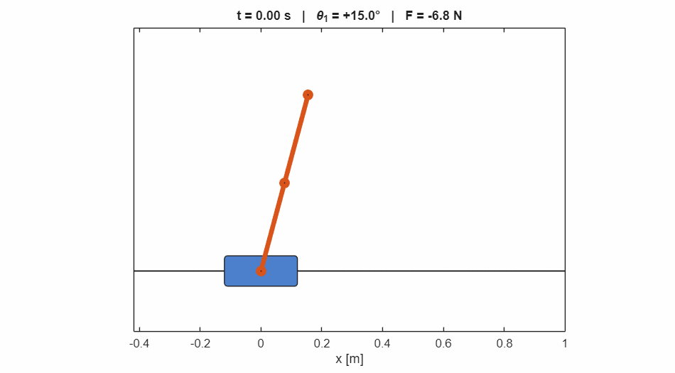
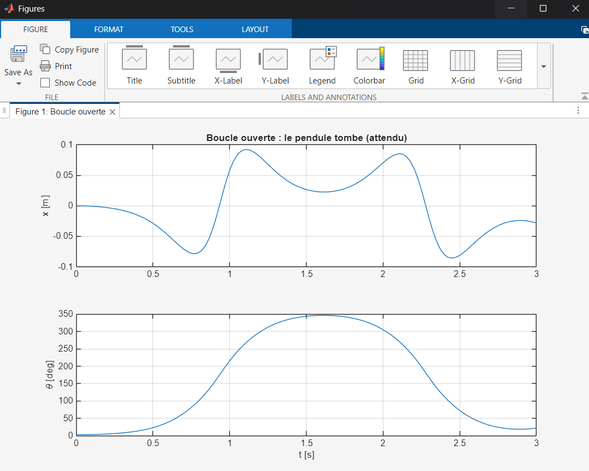
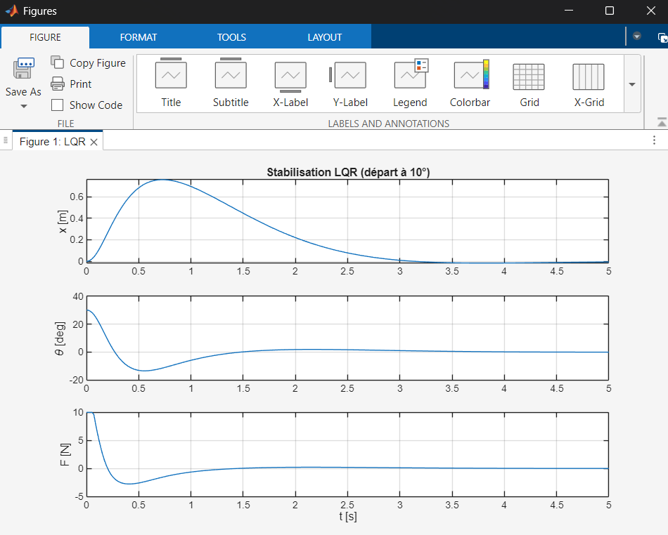
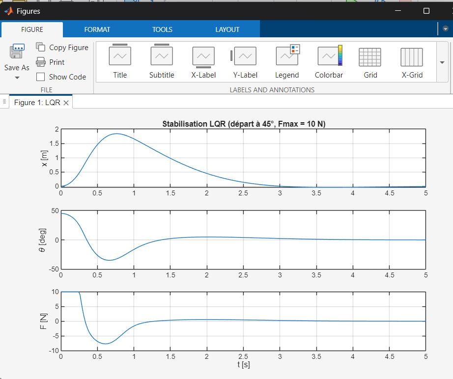
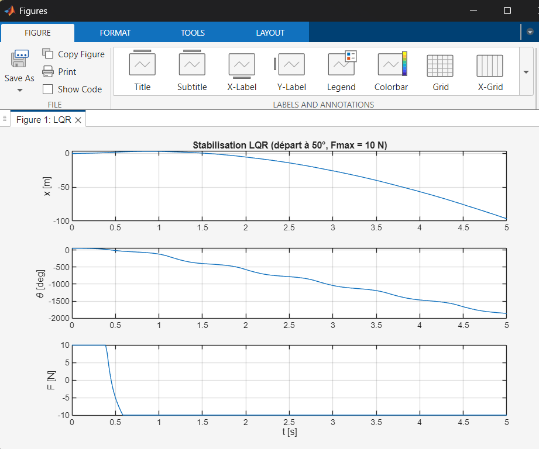
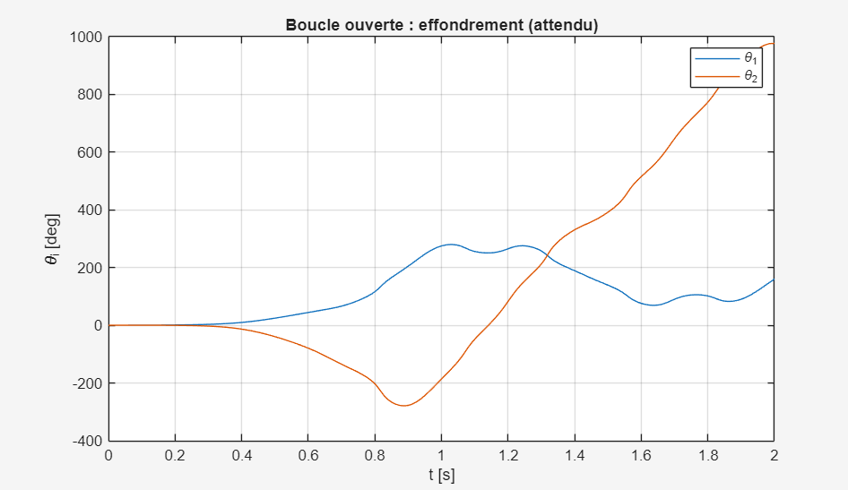
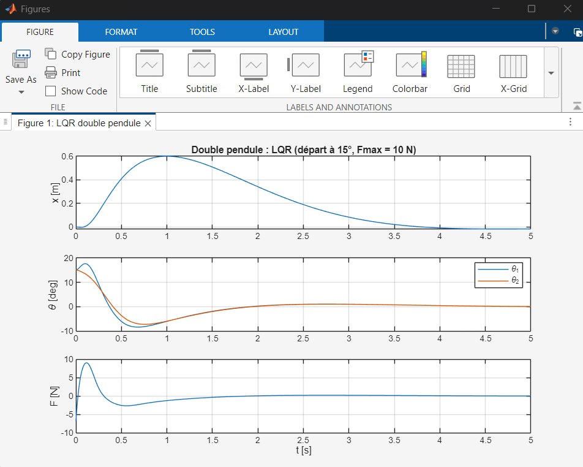
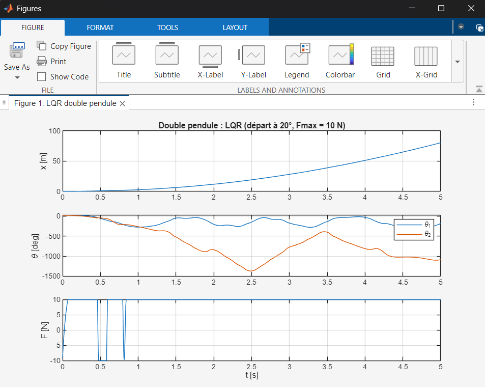

# Stabilisation LQR d'un pendule inversé simple et double sur chariot

Modélisation par les équations de Lagrange, commande optimale LQR et étude des limites en présence de saturation de l'actionneur — MATLAB.

<p align="center">
  
</p>

## Points clés

- Modèle non linéaire établi **à la main** par les équations de Lagrange, puis automatisé et généralisé à *N* barres avec la Symbolic Math Toolbox
- Validation du modèle : **conservation de l'énergie** (dérive < 1e-8 J sans frottement) et cohérence des pôles avec le calcul manuel
- Commande **LQR** conçue sur le modèle linéarisé, testée sur le modèle **non linéaire complet**
- Étude de la **saturation moteur** (±10 N) : domaine de stabilisation de **45°** pour le pendule simple contre **15°** pour le double pendule

## Contenu du dépôt

```
src/
├── derive_eom.m          Modèle du pendule simple (Lagrange, linéarisation, validation)
├── derive_eom_nlink.m    Modèle générique à N barres (utilisé avec N = 2)
├── lqr_pendule.m         Commande LQR du pendule simple
└── lqr_double.m          Commande LQR du double pendule
figures/                  Résultats de simulation
```

---

## 1. Modélisation du pendule simple

**État :** $X = [x,\ \theta,\ \dot{x},\ \dot{\theta}]$, avec $\theta = 0$ en position haute.
**Commande :** force $F$ appliquée au chariot.

Le lagrangien $L = T - V$ s'écrit :

$$
L = \tfrac{1}{2}(M+m)\dot{x}^2 + ml\cos\theta\,\dot{x}\dot{\theta} + \tfrac{1}{2}(J+ml^2)\dot{\theta}^2 - mgl\cos\theta
$$

Le terme $ml\cos\theta\,\dot{x}\dot{\theta}$ couple le chariot et le pendule : c'est lui qui rend le système commandable avec une seule entrée.

Les équations de Lagrange donnent :

$$
(M+m)\ddot{x} + ml\cos\theta\,\ddot{\theta} - ml\sin\theta\,\dot{\theta}^2 + b\dot{x} = F
$$

$$
(J+ml^2)\ddot{\theta} + ml\cos\theta\,\ddot{x} - mgl\sin\theta = 0
$$

**Linéarisation** autour de la position haute ($\sin\theta \approx \theta$, $\cos\theta \approx 1$, $\dot{\theta}^2 \approx 0$) :

$$(M+m)\ddot{x} + ml\,\ddot{\theta} + b\dot{x} = F$$

$$ml\,\ddot{x} + (J+ml^2)\ddot{\theta} - mgl\,\theta = 0$$

L'inversion de la matrice de masse donne la représentation d'état $\dot{X} = AX + BF$.

**Paramètres :** $M = 0{,}5$ kg, $m = 0{,}2$ kg, $l = 0{,}3$ m, $J = 0{,}006$ kg·m², $b = 0{,}1$ N·s/m.

### Validation du modèle

| Test | Résultat |
|---|---|
| Pôles en boucle ouverte | 0 ; **+5,57** ; −5,61 ; −0,14 |
| Pôle instable prévu à la main (sans frottement) | ±5,6 rad/s ✓ |
| Dérive d'énergie (b = 0, 3 s) | 4,6e-9 J ✓ |

<p align="center">
  
</p>

En boucle ouverte, le pendule tombe puis se balance autour de sa position basse. Le chariot bouge en sens inverse du pendule : le centre de gravité commun reste quasiment immobile.

---

## 2. Commande LQR du pendule simple

La loi de commande est un retour d'état $F = -KX$. Le gain $K$ minimise :

$$
J = \int_0^\infty \left( X^\top Q X + R\,F^2 \right) dt
\qquad Q = \mathrm{diag}(10,\ 100,\ 1,\ 1), \quad R = 1
$$

La priorité est donnée à l'angle du pendule (100), puis au retour du chariot au centre (10).

| | Valeur |
|---|---|
| Gain $K$ | [−3,16 ; −28,61 ; −3,98 ; −5,18] |
| Pôles en boucle fermée | −7,03 ± 2,59i (pendule) ; −1,23 ± 1,01i (chariot) |
| Temps d'établissement du chariot | ≈ 3,3 s |

<p align="center">
  
</p>

**Observation :** pour ramener le chariot au centre, le contrôleur fait d'abord pencher légèrement le pendule dans la direction du retour (θ ≈ −3,5°), puis le chariot « suit » cette inclinaison. Le système est à **non-minimum de phase** : pour aller à gauche, il faut d'abord pousser à droite.

### Limites en présence de saturation (±10 N)

| Angle initial | Résultat | Déplacement max du chariot |
|---|---|---|
| 10° | stabilisé | 0,2 m |
| 30° | stabilisé | 0,75 m |
| 40° | stabilisé | 1,3 m |
| 45° | stabilisé (limite) | 1,8 m |
| 50° | **échec** | — |

<p align="center">
  
  
</p>

Le pendule simple **tolère une saturation temporaire** : jusqu'à 45°, le moteur reste bloqué à 10 N pendant une fraction de seconde mais le pendule est rattrapé. Sur un banc réel, la longueur des rails serait cependant la contrainte la plus limitante.

---

## 3. Double pendule inversé

Le modèle est généré par `derive_eom_nlink.m` sous forme matricielle $M(q)\ddot{q} + h(q,\dot{q}) = Q$, avec des angles absolus mesurés depuis la verticale. Le système compte 3 degrés de liberté, soit **6 états**.

**Paramètres :** chariot 1 kg, deux barres de 0,1 kg et 0,3 m.

| Test | Résultat |
|---|---|
| Pôles instables | **+13,3** (déformation en zigzag) ; **+5,2** (basculement d'un bloc) |
| Commandabilité | rang 6/6, conditionnement 2e5 |
| Dérive d'énergie (b = 0) | 6,7e-10 J ✓ |

<p align="center">
  
</p>

En boucle ouverte, le mode le plus rapide (zigzag) domine dès 0,3 s, puis le mouvement devient chaotique.

### Commande LQR

Même méthode, avec $Q = \mathrm{diag}(10,\ 100,\ 100,\ 1,\ 1,\ 1)$ et $R = 1$.

| | Valeur |
|---|---|
| Gain $K$ | [3,16 ; −141,7 ; 167,8 ; 4,94 ; −3,20 ; 16,34] |
| Pôles en boucle fermée | −15,1 ; −11,9 ; −5,98 ± 2,53i ; −0,97 ± 0,86i |

Les gains sur les angles sont de **signes opposés** : le contrôleur réagit à la différence entre les deux barres, c'est-à-dire au début d'une déformation en zigzag. Au démarrage, il tire d'abord le chariot dans le mauvais sens pour redresser la barre supérieure, avant de rattraper l'ensemble.

### Limites en présence de saturation (±10 N)

| Angle initial | Résultat | Force max | Déplacement max du chariot |
|---|---|---|---|
| 5° | stabilisé | 2,7 N | 0,2 m |
| 10° | stabilisé | 5,5 N | 0,4 m |
| 15° | stabilisé (limite) | ≈ 9 N | 0,6 m |
| 20° | **échec** | saturée | — |

<p align="center">
  
  
</p>

---

## 4. Analyse

| | Pendule simple | Double pendule |
|---|---|---|
| Pôles instables | 1 (+5,6) | 2 (+13,3 ; +5,2) |
| Gain maximal sur un angle | 28,6 | 167,8 |
| Angle initial maximal (±10 N) | **45°** | **15°** |
| Tolérance à la saturation | oui | non |

Contrairement au pendule simple, le double pendule **ne tolère aucune saturation** : dès que la force demandée dépasse 10 N, la coordination fine entre les deux barres est rompue et le mode instable rapide diverge en une fraction de seconde. Les gains élevés rendent aussi ce système beaucoup plus sensible au bruit de mesure.

## 5. Utilisation

Prérequis : MATLAB avec Symbolic Math Toolbox et Control System Toolbox.

```matlab
cd src
derive_eom          % génère le modèle du pendule simple
lqr_pendule         % commande LQR du pendule simple

% Dans derive_eom_nlink.m, régler N = 2, puis :
derive_eom_nlink    % génère le modèle du double pendule
lqr_double          % commande LQR du double pendule
```

Les paramètres `angle0` (angle initial) et `Fmax` (saturation) se modifient en tête de section dans les scripts de commande.

## 6. Prochaines étapes

- [ ] Animation du chariot et des barres
- [ ] Swing-up par contrôle de l'énergie (pendule simple)
- [ ] Observateur de Kalman (mesure de x et θ seulement)
- [ ] Validation du modèle dans Simscape Multibody

---

**Auteur :** Taha Bouchama — Master 1 AM2AS (Automatique, Mécatronique, Aéronautique & Spatial), Université de Bordeaux
[LinkedIn](https://www.linkedin.com/in/taha-bouchama-981085266/)
